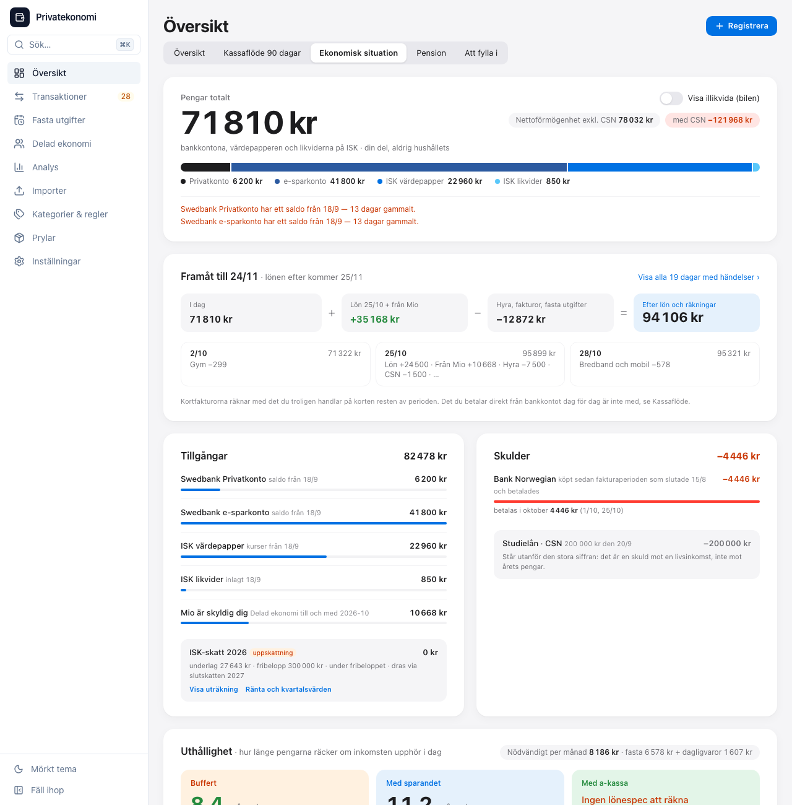
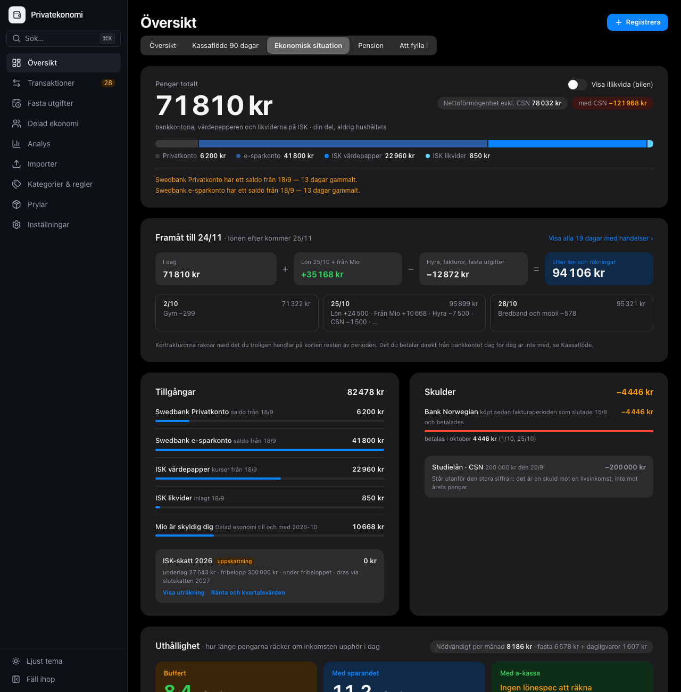
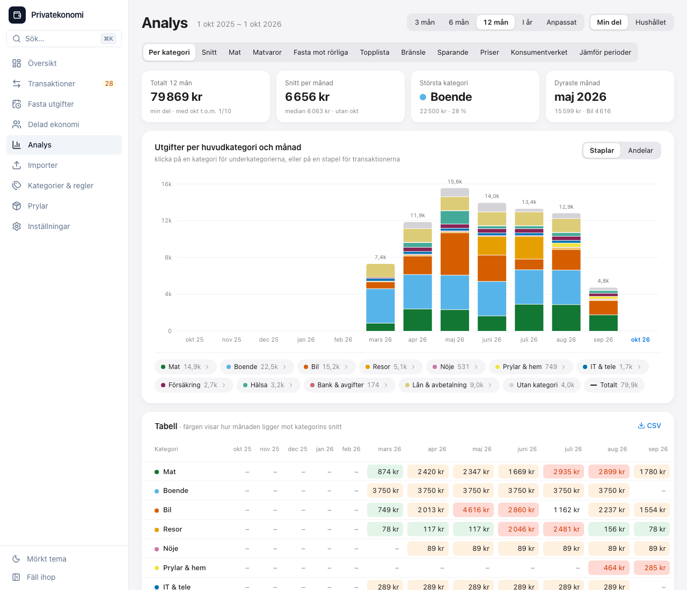
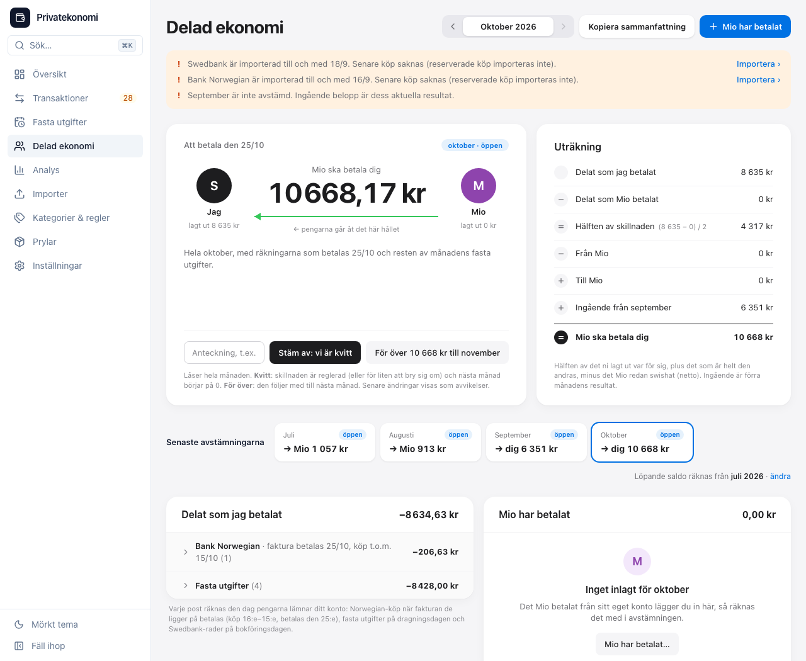
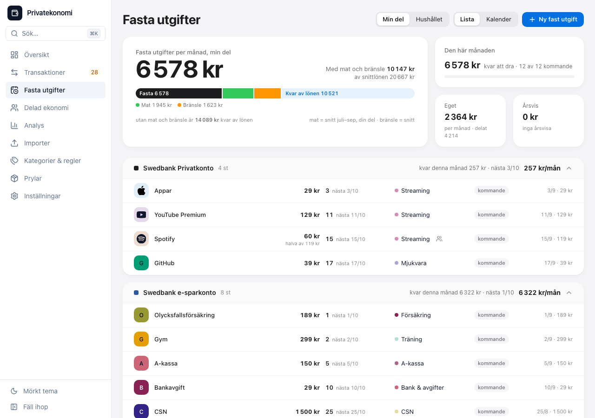

# Privatekonomi

Ett verktyg för hushållets ekonomi, byggt för **Sverige**: svenska banker och filformat, svenska skatteregler (ISK, KPI, Konsumentverkets referensbudget) och ett gränssnitt på svenska. Det körs på din egen dator eller server. Ingen molntjänst, ingen inloggning hos någon, och all data ligger i en SQLite-fil som är din.

Det du får:

- **Översikt:** vad som är kvar att leva på till nästa lön, en prognos för räkningar och fasta utgifter, och vad som behöver uppmärksamhet.
- **Transaktioner:** import från bankens filer, automatisk kategorisering med regler du bygger själv, dubblettskydd och att granska det som saknar kategori.
- **Fasta utgifter:** abonnemang, hyra och försäkringar kopplas till dragningarna i banken, med påminnelser om sådant som förnyas eller ändrar pris.
- **Delad ekonomi:** hur ni delar utgifterna i hushållet och vad som ska swishas, månad för månad, med avstämning.
- **Analys:** kategorier, snitt, mat mot restaurang, fasta mot rörliga utgifter, topplista över handlare och en jämförelse med Konsumentverkets referensbudget.
- **Sparande och pension:** ISK, innehav och kurser, avkastning efter inflation, ISK-skatt, pension och nettoförmögenhet.
- **Valfritt:** hämtning direkt från banken via Enable Banking, veckosammanfattning och varningar med ntfy, löneprognos och pendling (moduler som är avstängda från början).

<p align="center">
  
  
</p>
<p align="center">
  
  
  
</p>

Skärmdumparna är från demodatan: allt i dem är påhittat.

> Verktyget är ett hjälpmedel för dig som vill ha koll. Siffror och skatteberäkningar kan vara fel, och inget i det är ekonomisk eller skattemässig rådgivning. Kontrollera mot bankens egna uppgifter och Skatteverket. Se [LICENSE](LICENSE) för villkoren.

## Prova det

Du behöver [Node.js](https://nodejs.org) 24 och git.

```bash
git clone <adressen till det här repot>
cd privatekonomi
npm ci
npm run demo
```

`npm run demo` gör en databas för ett påhittat hushåll (`data/demo/`) och startar verktyget på den: öppna <http://localhost:5174>. Allt i den är hittepå. Det är samma databas varje gång tills du tar bort den.

## Använda det på riktigt

```bash
npm ci
npm start            # bygger webbappen och startar den på http://127.0.0.1:3001
```

Första gången skapas databasen i `data/finance.db`. Öppna sidan och följ [Kom igång](docs/KOMIGANG.md): skapa dina konton, importera en export från banken, och sätt kategorier på det som blir över. Importen görs med bankens egna filer. Verktyget loggar aldrig in i din bank, om du inte själv kopplar det via Enable Banking.

| Läs | Om |
|---|---|
| [Kom igång](docs/KOMIGANG.md) | De första tio minuterna: konton, import, kategorier och fasta utgifter |
| [Banker](docs/BANKER.md) | Hur du exporterar från din bank, och hur en bank utan färdig import läses in som CSV |
| [Använda verktyget](docs/ANVANDNING.md) | Handboken: varje vy, månadsrutinen och avstämningen |
| [Drift](docs/DRIFT.md) | Docker, en egen server, säkerhetskopior, åtkomst utifrån och Enable Banking |
| [SPEC.md](SPEC.md), [UI-SPEC.md](UI-SPEC.md) | Vad som är byggt och hur gränssnittet ser ut, för den som vill ändra |
| [CONTRIBUTING.md](CONTRIBUTING.md) | Att utveckla, testa och bidra |

## Banker

| | Hur |
|---|---|
| **Swedbank** (Privatkonto, e-sparkonto) | Importerar bankens CSV. Överföringar mellan dina konton känns igen. |
| **Bank Norwegian** | Importerar månadsexporten (XLSX) och fakturan (PDF). |
| **Swedbank Mastercard** | Importerar fakturan (PDF) och transaktionslistan. |
| **Vilken annan bank som helst** | **Allmän CSV-import:** du pekar ut vilken kolumn som är datum, text och belopp en gång, och verktyget minns det för kontot. Se [Banker](docs/BANKER.md). |
| **Direkt från banken** | Enable Banking (valfritt) hämtar Swedbank och Bank Norwegian automatiskt. Det kräver ett eget konto där. Se [Drift](docs/DRIFT.md). |

## Säkerhet och integritet

- **Det finns ingen inloggning.** Den som når sidan ser allt och kan ändra allt. Därför lyssnar verktyget bara på `127.0.0.1` (den egna datorn) och porten i `compose.yml` är publicerad bara där. **Lägg aldrig verktyget på internet.** Vill du nå det från mobilen, gör det bakom en VPN som Tailscale eller WireGuard: [Drift](docs/DRIFT.md).
- **Datan stannar hos dig.** Databasen är en fil i `data/`. Bankens filer sparas inte, bara raderna ur dem (undantaget är en hyresavi du läser in: dess PDF ligger i databasen). Kontonummer sparas bara maskerade (`••1234`).
- **Det som går ut på nätet** är publika uppgifter som verktyget hämtar för sparande och prognoser: valutakurser (Riksbanken), konsumentprisindex (SCB), bränslepriser (EU:s Oil Bulletin) och fondkurser (Yahoo Finance och Avanzas publika kursdata, för de innehav du har lagt in; den som hämtar ser alltså vilka tickers du följer). Dessutom, bara om du slår på det: Enable Banking (din bankdata), ntfy (notiser) och en Uptime Kuma-adress.
- **Säkerhetskopior** tas automatiskt (se [Drift](docs/DRIFT.md)), men flytta gärna `data/backups/` till en annan disk då och då.

## Utveckling

```bash
npm run dev:test     # utveckling mot en testdatabas (API 3101, webb 5174)
npm test             # alla tester (server och webb)
npm run typecheck
```

Se [CONTRIBUTING.md](CONTRIBUTING.md). Koden är TypeScript: Hono, better-sqlite3 och Drizzle på servern, React 19, Vite och Tailwind v4 i webben.

## Licens

[GNU Affero General Public License v3 eller senare](LICENSE). Du får använda, ändra och dela verktyget. Kör du en ändrad version som en tjänst för andra måste du dela dina ändringar med dem.
